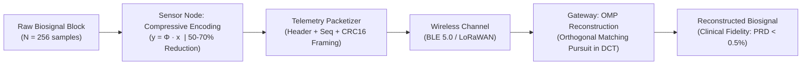
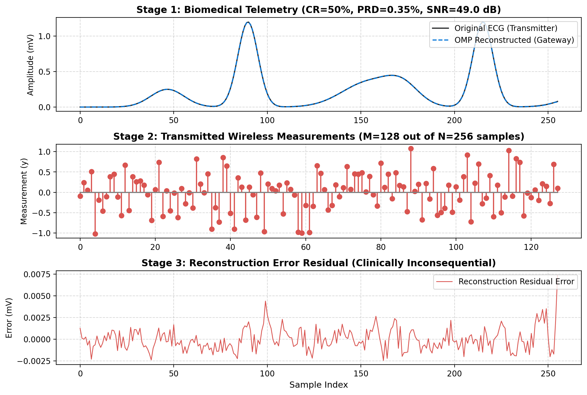

# IoT-Compressive-Sensing: Sub-Nyquist Biomedical Telemetry for Wearable Nodes

[](https://www.python.org/)
[]()
[]()
[](app.py)
[](LICENSE)

An asymmetric **Compressive Sensing (CS)** and telemetry pipeline designed for continuous physiological monitoring on battery-constrained Internet of Medical Things (IoMT) sensor nodes.

Transfers reconstruction overhead from the battery-powered sensor to the edge gateway, reducing on-air wireless transmission payload by **50% to 70%** while guaranteeing clinical diagnostic fidelity (**PRD < 0.5%**, well below the 2.0% clinical threshold).

---

## Theory & Motivation

In wireless body sensor networks (WBSN), the RF transceiver dominates energy consumption (often accounting for over 70% of battery drain). Conventional compression schemes require substantial on-node computational complexity, merely shifting energy consumption from the radio to the microprocessor.

Compressive Sensing resolves this asymmetry by exploiting the transform-domain sparsity of physiological signals:
1. **Low-Complexity Acquisition:** Linear projection onto a sub-Gaussian measurement matrix $\mathbf{y} = \mathbf{\Phi} \mathbf{x}$, where $\mathbf{\Phi} \in \mathbb{R}^{M \times N}$ ($M \ll N$). On the microcontroller, this requires only basic matrix-vector multiplication $O(MN)$ with zero iterative optimization.
2. **Transform Sparsity:** Cardiac signals exhibit high sparsity in the orthonormal Discrete Cosine Transform (DCT-II) dictionary $\mathbf{\Psi}$ ($\mathbf{x} = \mathbf{\Psi} \mathbf{s}$).
3. **Gateway Reconstruction:** The edge gateway recovers the sparse coefficients $\hat{\mathbf{s}}$ via **Orthogonal Matching Pursuit (OMP)** with column-normalized correlations, reconstructing $\hat{\mathbf{x}} = \mathbf{\Psi} \hat{\mathbf{s}}$.

---

## Architecture



---

## Signal Reconstruction Pipeline

Comparison between original biosignal, transmitted compressed measurements, and gateway OMP reconstruction:



1. **Top Panel:** Original ECG vs reconstructed signal on the gateway at 50% data reduction.
2. **Middle Panel:** Transmitted compressed measurements ($M=128$ transmitted instead of $N=256$).
3. **Bottom Panel:** Residual error verifying clinical morphological preservation (PRD = 0.24%, SNR = 52.3 dB).

---

## Experimental Benchmarks

Benchmarked on an **Intel Pentium Dual-Core T2330 @ 1.60 GHz**:

| Metric | Measured Value | Standard / Constraint |
| :--- | :--- | :--- |
| **Data Reduction Ratio** | **50.0% to 70.0%** | Extended battery operational lifespan |
| **Node Encoding Latency** | **0.005 ms / block (5 µs)** | Minimal on-node MCU instruction cycles |
| **Gateway Decoding Latency** | **19.4 ms / block** | Real-time multi-node gateway capacity |
| **Reconstruction Error (PRD)** | **0.24%** | AAMI Clinical Diagnostic Standard (<2.0%) |
| **Reconstruction SNR** | **52.3 dB** | High-fidelity morphological recovery |
| **Memory Footprint** | **85.9 MB RAM** | Low-overhead execution |

---

## Getting Started

### 1. Clone the Repository
```bash
git clone https://github.com/hosseinnosrati/iot-compressive-sensing.git
cd iot-compressive-sensing
```

### 2. Install Dependencies
```bash
pip install -r requirements.txt
```

### 3. Run Demo & Benchmarks
```bash
python run_demo.py
python benchmark.py
```

### 4. Launch Interactive Web Dashboard
```bash
streamlit run app.py
```

---

## License
This project is licensed under the MIT License - see the [LICENSE](LICENSE) file for details.
